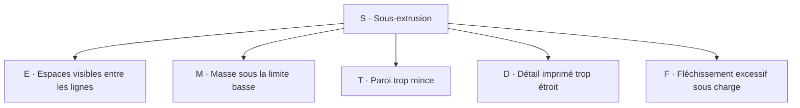

# Réseau bayésien pour le contrôle qualité en impression 3D

L’opérateur contrôle une pièce terminée d’un modèle donné. Le réseau estime
la probabilité de sous-extrusion à partir des indices relevés sur la pièce.

Le défaut et les cinq indices sont binaires. Les indices sont supposés
mutuellement indépendants sachant l’état du défaut $S$. La loi jointe se
factorise ainsi.

$$
P(S,E,M,T,D,F)
= P(S)P(E\mid S)P(M\mid S)P(T\mid S)P(D\mid S)P(F\mid S).
$$

Les [tables de probabilités](CPT.md) donnent les paramètres fictifs de la
simulation et des exemples de diagnostic. Chaque indice indisponible est
marginalisé en sommant sur ses deux états possibles.

## Décision de contrôle

La règle de décision utilise la probabilité de sous-extrusion calculée à
partir des observations disponibles. Les deux seuils et le contrôle de
confirmation restent à définir.

| Probabilité estimée | Action |
| --- | --- |
| Sous le seuil bas | Accepter la pièce au titre de ce contrôle |
| Du seuil bas inclus au seuil haut exclu | Approfondir le contrôle |
| Au seuil haut ou au-dessus | Écarter la pièce du lot |
