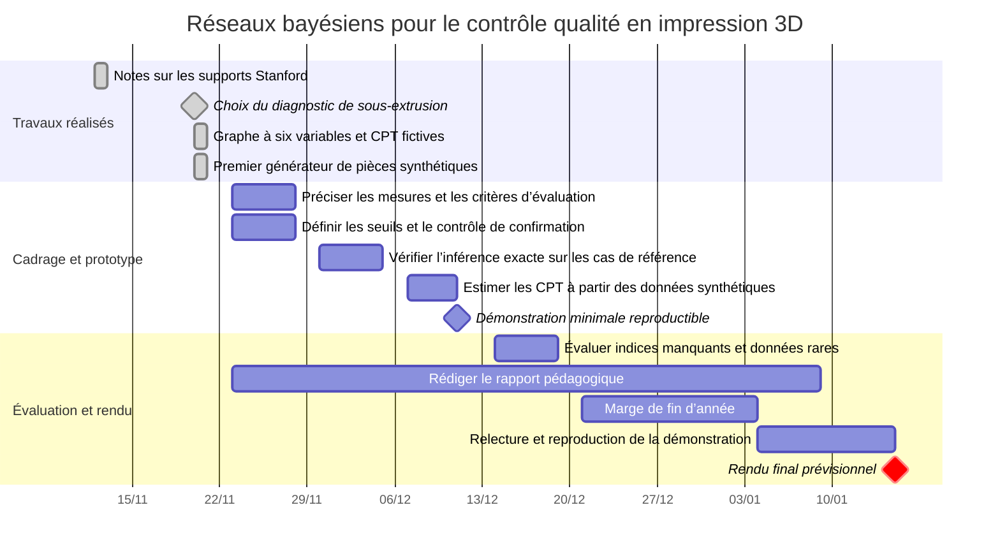

# Planning prévisionnel du projet

Mise à jour du 20 novembre 2026. Le projet porte sur le diagnostic de
sous-extrusion et l’aide à la décision lors du contrôle de pièces imprimées en 3D.
Le **vendredi 15 janvier 2027** sert de date de travail, à confirmer avec
l’encadrant.

Le [graphe](GRAPH.md) décrit le diagnostic et les trois actions possibles.
Les [CPT](CPT.md) servent de référence pour simuler les pièces et vérifier
l’apprentissage. L’évaluation compare les paramètres estimés aux paramètres
de simulation et vérifie le calcul du diagnostic lorsque certains indices
sont indisponibles. Gibbs et EM restent des extensions possibles pour
l’inférence approchée et l’apprentissage sur données incomplètes.

## Priorités proposées

| Niveau | Objectif | Preuve d'achèvement envisagée |
| --- | --- | --- |
| Nécessaire | Formaliser un cas d'usage limité et ses hypothèses | Question, variables, utilisateurs et exclusions explicités |
| Nécessaire | Documenter les réseaux bayésiens et les méthodes retenues | Ressources annotées et explications reliées au cas |
| Nécessaire | Implémenter inférence et apprentissage des paramètres dans le périmètre convenu | Exemple reproductible et vérifications de cohérence |
| Nécessaire | Évaluer le prototype et ses limites | Critères définis au cadrage, expériences traçables |
| Nécessaire | Assurer suivi et versionnement | Journal, comptes rendus, dépôt public et historique lisible |
| Nécessaire | Rédiger un rapport pédagogique | Fil conducteur du besoin jusqu'aux résultats et limites |
| Intéressante | Étudier la sensibilité aux paramètres et aux données rares | Comparaisons sur scénarios contrôlés |
| Intéressante | Comparer plusieurs méthodes pertinentes | Protocole commun et discussion des écarts |
| Optionnelle | Ajouter une interface de démonstration | Parcours illustrant les résultats du prototype |
| Optionnelle | Étendre à la structure du graphe ou à un second cas | Seulement après stabilisation du socle |
