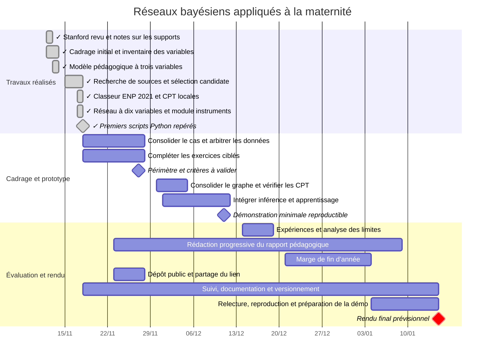

# Gantt prévisionnel du projet

Mise à jour du 18 novembre 2026. Le rendu est prévu à la mi-janvier 2027.
Le **vendredi 15 janvier 2027** .

- Les travaux réalisés sont détaillés dans le journal de projet. Le 18 novembre
  correspond au constat de présence des scripts Python. Leur intégration et
  leur vérification font partie du prototype à consolider.
- Le jalon du 27 novembre sert de repère pour arbitrer le cas d'usage avec
  l'encadrant. Le calendrier sera ajusté après la première réunion et selon les
  disponibilités de fin d'année.
- La démonstration prévoit un jeu synthétique si les données publiques ne
  permettent pas d'estimer les probabilités nécessaires au graphe retenu.
  Les tableaux ENP et leurs CPT locales alimentent le travail descriptif.
- La période du 21 décembre au 3 janvier sert de marge. Les expériences
  nécessaires sont prévues avant cette période et la relecture finale débute le
  4 janvier.

## Priorités proposées

| Niveau | Objectif | Preuve d'achèvement envisagée |
| --- | --- | --- |
| Nécessaire | Formaliser un cas d'usage limité et ses hypothèses | Question, variables, utilisateurs et exclusions explicités |
| Nécessaire | Documenter les réseaux bayésiens et les méthodes retenues | Ressources annotées et explications reliées au cas |
| Nécessaire | Implémenter inférence et apprentissage des paramètres dans le périmètre convenu | Exemple reproductible et vérifications de cohérence |
| Nécessaire | Évaluer le prototype et ses limites | Critères définis au cadrage, expériences traçables |
| Nécessaire | Assurer suivi et versionnement | Journal, comptes rendus, dépôt public et historique lisible |
| Nécessaire | Rédiger un rapport pédagogique | Fil conducteur du besoin jusqu'aux résultats et limites |
| Intéressante | Étudier la sensibilité aux paramètres et aux données rares | Comparaisons sur scénarios contrôlés |
| Intéressante | Comparer plusieurs méthodes pertinentes | Protocole commun et discussion des écarts |
| Optionnelle | Ajouter une interface de démonstration | Parcours illustrant les résultats du prototype |
| Optionnelle | Étendre à la structure du graphe ou à un second cas | Seulement après stabilisation du socle |

EM et les données manquantes seront reclassés en nécessaires s'ils font partie
du cas retenu ; aucun algorithme n'est imposé par ce planning.
La rédaction et la documentation avancent dès le début, pas seulement en décembre.
